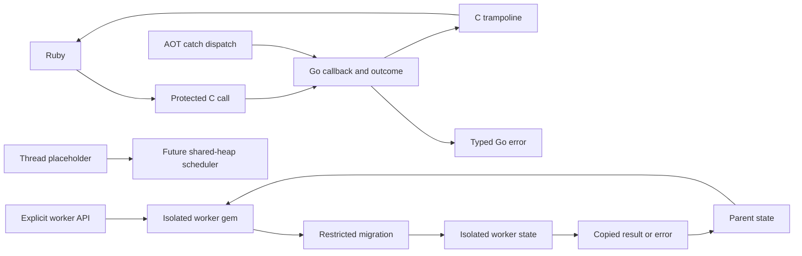

# Requirements

### First milestone
- Make protected Ruby-to-Go-to-Ruby calls distinguish successful values, Ruby exceptions, and non-local control flow. Ruby `rescue` and `ensure` execute at the appropriate Ruby boundary; Go callers receive `(value, error)`. Exercise this through interpreted and AOT execution.
- Preserve the existing cloned-mruby-state worker implementation in a separate, opt-in `isolated_worker` gem with its own API, independent of Ruby `Thread`. Harden supported transfers and worker lifecycle; reject unsafe cases instead of passing foreign pointers between heaps.
- Retain the minimal `Thread` identity needed by existing code, but make thread creation explicitly unsupported until a real shared-heap implementation exists. Document the breaking change for current `Thread.new` users.

### Boundaries
The clone is a potential building block for a future portable fork-like facility, not `Process.fork`: it does not create an OS process, clone the entire runtime or execution stack, provide a PID, process isolation, file-descriptor semantics, or process `wait`/signals. Do not implement or advertise `fork` in this milestone; `IO.popen('-')` remains unsupported. This milestone also excludes a Ruby-compatible thread scheduler, complete worker API, all Ruby specs, Rails support, and general thread-safe `MrbState` access. It does not promise interruption of arbitrary native or CPU-bound code. Preserve existing uncommitted changes; `mruby/` is read-only.

# Technical Design

### Current implementation
- `go-mrb.h` wraps calls, yields, and loads with C-local jump protection; `go-mrb.c` resumes a pending exception only after a Go callback returns. `mruby.go` currently infers some failures from the returned value's type, so a normally returned exception object can be mistaken for an error.
- `goaot.go` and `compiler/codegen.go` already implement pending exceptions and generated rescue/ensure dispatch; these need behavioral verification, not wholesale replacement.
- `gem/thread/context.go` launches a separate state per worker, while `migrate.go` can retain source-state pointers. `linkrefs.go` reads the global state registry without its write lock and has a broken reuse assignment.
- `gem/thread/thread.go` registers `Thread`, synchronization classes and sleep together; `gem/fullcore/fullcore.go` imports it. `gem/core_ext/ruby/03_thread.rb` and array/hash extensions rely on `Thread.current`, and `gem/core_ext/ruby/08_module.rb` implements `Process.detach` using `Thread.new`. `gem/process/process.go` intentionally leaves `fork` unregistered.

### Decisions and contracts
- Keep mruby's C-local `longjmp` machinery; never intentionally allow a jump across an active Go frame. In protected call/yield/load paths, introduce an internal tagged outcome: success with a Ruby value, Ruby exception, or non-local control flow. Normal exception-valued returns remain successes. Restore pending exception state and VM/arena state correctly for nested calls, using the supported mruby protection mechanism.
- Preserve existing public `(value, error)` signatures where possible; add checked adapters where a legacy value-only API cannot express failure. Callback propagation must preserve the original exception/control object to the C trampoline after Go defers run. Audit and protect or explicitly mark unsafe direct raising APIs such as `ExcRaise` and `FRaise`; do not claim every mruby wrapper has been audited.
- Expose a typed Go-facing Ruby error with stable class, message, and backtrace snapshots. When the original Ruby object must be retained for re-entry, use a state-owned GC root with explicit, idempotent release; reject cross-state reuse and invalidate handles on state close. Do not rely on a Go finalizer to access mruby. Define consumption and restoration of pending exceptions for nested calls and formatting failures.
- Move the cloned-state worker and migration machinery from `gem/thread` into `gem/isolated_worker`, retaining its implementation for future reuse rather than deleting it. Register `isolated_worker` with `oruby.LazyGem`; users blank-import the Go gem and activate it with `mrb.Resolve("isolated_worker")` or Ruby `require "isolated_worker"` when `gem/load` is present. Do not include it automatically in `fullcore` or register `Thread` from it. Expose `ORuby::IsolatedWorker.new(*args, &block)`, `join(timeout = nil)` and `value`: completed `join` returns the worker, timed-out `join` returns `nil`, and `value` returns the copied result or propagates the worker failure. This API has isolated heaps, not Ruby thread semantics.
- Retain a minimal main `Thread.current` object and existing non-worker synchronization classes in `gem/thread` for `core_ext`; make `Thread.new`, `start` and `go` fail explicitly without creating cloned workers. Document that `Process.detach` currently relies on `Thread.new` and is consequently unsupported; do not silently make it launch an isolated worker. Existing mutex/queue correctness is not certified by this change.
- Keep cloned-state workers experimental. Only migrate values and closure environments that can be proven safe; guard and retain unsupported migration code for future work while rejecting unsupported objects, Go-backed data, cycles, and aliases rather than copying foreign pointers or silently changing identity. Copy arguments into destination-owned storage, intern symbols in the destination, and never install a source proc in a child environment. Unsafe stop, kill, and direct Go-callback paths fail explicitly rather than masquerading as supported behavior.
- Synchronize registry reads and writes and fix slot reuse, without treating this as permission for concurrent access to one state. Supervise parent/child lifetime and worker completion; child results and exceptions remain rooted until copied or released, and worker errors are reported consistently. Convert child failures to a safe snapshot and create a parent-owned error or exception; never reuse a child exception handle in the parent state. Timed join must not spuriously wake or block before its deadline. Uninterruptible workers may delay shutdown and must be documented.

### Interaction

### Files
- `go-mrb.h`, `go-mrb.c`, `mruby.go`, `error.go`, `goerror.go`, `goobject.go`: protection, outcomes, callback propagation, error lifetime, and compatibility adapters.
- `goaot.go`, `go-aot.h`, `compiler/codegen.go`, `compiler/decoder.go`: integrate the boundary contract with existing AOT dispatch only where tests demonstrate a mismatch.
- `linkrefs.go`: synchronized state registry.
- New `gem/isolated_worker/` package and README: extracted worker context and migration code, opt-in registration, worker API, safety and lifecycle rules.
- `gem/thread/context.go`, `gem/thread/migrate.go`, `gem/thread/thread.go`, and `gem/thread/README.mkd`: extract the clone machinery, retain minimal main-thread support and document the compatibility break; retain existing synchronization classes without claiming their correctness.
- `Makefile`: add the new gem's tests. Keep `gem/fullcore/fullcore.go` free of a default isolated-worker import.
- Extend `goerror_test.go`, `compiler/compiler_test.go`, `gem/thread/thread_test.go`, and `gem/core_ext/core_ext_test.go`; add worker tests in the new gem.

### Later direction
After these foundations, separately evaluate a single-owner, shared-heap logical-thread scheduler, accounting for mruby fibers' C-boundary limitations and AOT suspension. Channels are suitable for scheduler notifications or isolated messages, not raw Ruby values. Separately investigate whether the preserved worker machinery can underpin a portable fork-like API; compare continuation, object graph, OS process, resource and isolation semantics before proposing any `fork` compatibility or process integration.

# Testing

### Validation
- Use existing `MrbOpen`/`Close` test patterns and the compiler's generated-program build harness. Compare interpreted and compiled observable results; use CRuby as an additional oracle when available, distinguishing documented mruby differences.
- Verify nested Ruby → Go → Ruby raises, nearest rescue, ensure ordering, Go defers, normal exception-object returns, re-raises, ignored checked failures, `break`, nested pending state, and failures during exception formatting. Run potentially fatal longjmp scenarios in subprocesses.
- Force GC and arena restoration while retaining and releasing errors and worker results; test invalidation on close and cross-state rejection.
- Test registry reuse and concurrent independent state lifetimes; run focused tests with `go test -race` where supported. Test supported migration plus rejected cycles, aliases, recursive captures, and foreign Go-backed values.
- Test new-gem registration and explicit require, no implicit `Thread` or `Process.fork` replacement, and survival of main `Thread.current` and `core_ext` thread-local behavior. Verify `Thread.new` and dependent `Process.detach` fail explicitly.
- Test successful and failing isolated workers, copied arguments/results, repeated join/value, join timeouts, sleep, parent shutdown, and supported cancellation with bounded subprocess timeouts. Explicitly record unsupported interruption behavior rather than waiting indefinitely.
- Run relevant root, `gem/isolated_worker`, `gem/thread`, `gem/core_ext`, and `compiler` tests, then `go test ./...` and `go vet ./...` when the existing mruby build and environment permit; report failures and unverified cases.

# Delivery Steps

### ✓ Step 1: Establish protected exception outcomes
Protected interpreter calls distinguish successful values from exceptions and non-local control flow.

- Update the targeted C shims and callback trampolines in `go-mrb.h` and `go-mrb.c` to carry an explicit status and preserve nested VM state.
- Adapt call, yield, and load entry points in `mruby.go` and related wrappers; protect or explicitly mark direct raising APIs.
- Add subprocess-backed regression tests for rescue, ensure, Go defers, exception-valued returns, and control flow.

### ✓ Step 2: Preserve Go error identity and AOT behavior
Go callers receive a typed, lifetime-defined Ruby error, and targeted compiled cases follow the same exception contract.

- Implement safe error snapshots and state-owned retained exception handles in `goerror.go` and associated root wrappers.
- Integrate the outcome with `goaot.go` and existing generated catch dispatch without replacing working machinery.
- Add interpreted-versus-AOT and GC/lifetime regressions, including nested failures and exception formatting.

### ✓ Step 3: Extract cloned workers into an opt-in gem
The existing cloned-state implementation is preserved behind a separate isolated-worker API, not Ruby `Thread`.

- Move the worker and migration machinery from `gem/thread` into `gem/isolated_worker`; add lazy gem registration and the `ORuby::IsolatedWorker` entry point.
- Keep worker creation explicitly unavailable during the extraction until the transfer and lifecycle safety guards in the following stages are in place.
- Keep minimal main-thread identity in `gem/thread` for `core_ext`, and make unsupported thread creation fail explicitly rather than invoking cloned workers.
- Update the Makefile and tests for opt-in registration, `Thread.current`, the breaking `Thread.new` change, and the dependent `Process.detach` behavior.

### ✓ Step 4: Contain cross-state worker transfers
The state registry is synchronized and unsupported worker transfers fail before foreign values enter another heap.

- Fix registry lookup synchronization and slot reuse in `linkrefs.go`.
- Restrict the extracted migration code to safely copied values and destination-owned arguments and closure state, preserving guarded code for future development.
- Reject unsafe recursive, aliased, Go-backed, and unsupported transfers; add registry race and migration regression tests.

### ✓ Step 5: Supervise isolated workers and document limits
Supported isolated workers complete, join, and release resources predictably without claiming Ruby thread or OS fork semantics.

- Coordinate parent/child shutdown, completion publication, rooting, and safe cross-state error snapshots in the new worker context.
- Implement worker `join`, `value`, and timeout behavior; explicitly reject unsafe operations that cannot be made safe.
- Update both gem READMEs and worker tests, explain the future fork-like opportunity and present incompatibilities, and run focused and broader validation.

## Ruby 4.1 stdlib compatibility follow-up

### Scope and guardrails
- Continue using MRI Ruby 4.1 as the compatibility target. RubyGems and Bundler must come from authentic Ruby code for that target version; do not substitute another implementation/version.
- Reuse `cmd/oruby-spec-smoke/` and the existing stdlib/compiler work. Preserve unrelated worktree changes and keep `mruby/` read-only.
- Keep YAML object construction restricted; never weaken tests or Ruby-version guards merely to report a pass.

### Delivery Steps

### ✓ Step 6: Capture real-spec baseline
Run existing Base64, PP, OptionParser, and YAML dump spec files in interpreter and AOT modes with the smoke runner. Record exact tallies, tags, warnings, provenance, and any runner limitations before changing library behavior.

### ✓ Step 7: Add safe YAML symbol dumping
Implement and test YAML symbol serialization without enabling unsafe object loading; run the relevant real YAML dump spec in both modes.

### ✓ Step 8: Improve OptionParser compatibility
Use real specs and MRI comparison to add common typed conversions and optional arguments, with positive and negative tests.

### ✓ Step 9: Improve PrettyPrint and PP formatting
Implement tested width/group behavior guided by actual PP specs; preserve explicit limits for unsupported formatting semantics.

### ✓ Step 10: Validate compiler specialization
Add interpreter/AOT differential runtime tests for integer overflow and `self` handling in specialization; fix only demonstrated mismatches using safe fallback behavior.

### ✓ Step 11: Evaluate authentic RubyGems and Bundler integration
Verify availability and version provenance of Ruby 4.1 sources and loader prerequisites. Implement only a supportable, tested integration; otherwise report concrete blockers and remaining work without claiming completion.

## Ruby 4.1 follow-on work

### ✓ Step 12: Refresh the MRI 4.1 compatibility baseline
Run the selected Base64, PP, OptionParser, and YAML dump specs with MRI 4.1-preview1 in interpreter and AOT modes, capturing exact tallies, tags, warnings, and provenance.

### ✓ Step 13: Improve smoke-run reproducibility
Extend `cmd/oruby-spec-smoke/` only for concrete provenance or comparability gaps, while continuing to distinguish direct AOT entry execution from an MSpec-launched run.

### ✓ Step 14: Fix measured stdlib gaps
Use the refreshed real-spec results to implement focused compatibility fixes and tests in stdlib providers without weakening YAML safety or version guards.

### ✓ Step 15: Evaluate authentic RubyGems and Bundler loading
Use only authentic Ruby 4.1 target-version RubyGems and Bundler sources; integrate only if the existing runtime supports tested loading, otherwise record concrete blockers.

### ✓ Step 16: Expand compiler differential coverage
Add interpreter/AOT tests for concrete dispatch and arithmetic edge cases and fix only demonstrated mismatches with safe fallback behavior.